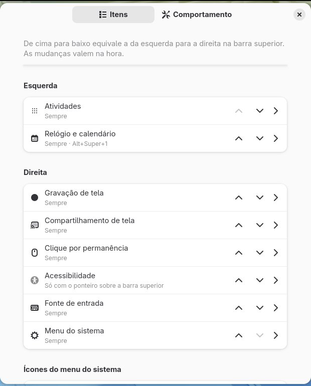
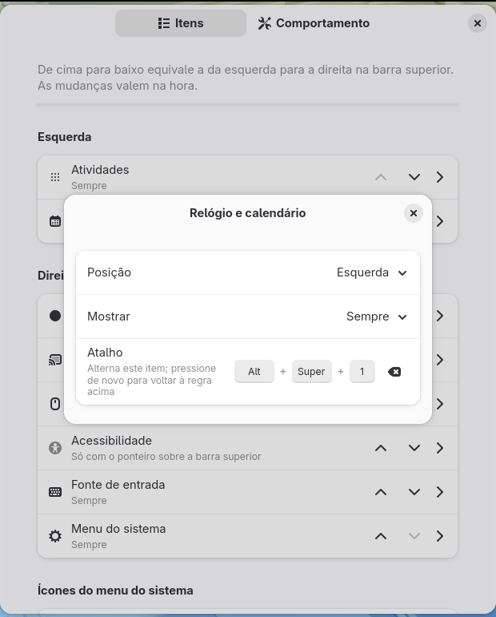
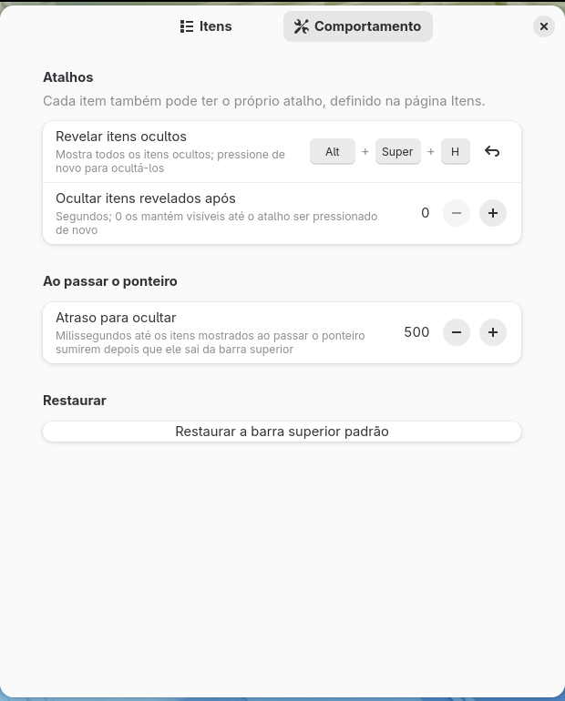

# Edit Top Bar

A GNOME Shell extension to rearrange, hide and show the items of the top bar.

Move any indicator to the left, center or right, reorder the small icons inside the system menu (network, volume, battery...) and choose **when** each item appears: always, never, only in the overview, only on hover, only on empty workspaces, and more. Every item can have its own keyboard shortcut, and one shortcut reveals everything that is hidden.

| Default top bar |
|---|
|  |
| **Clock moved to the left, system menu first on the right, battery icon first** |
|  |
| **Activities and volume hidden, an extension indicator shown only in the overview** |
|  |
| **After the "reveal hidden items" shortcut** |
|  |

| Items page | Item settings | Behavior page |
|---|---|---|
|  |  |  |

The screenshots are taken by the [smoke test](#smoke-test-buildsh-test). The preferences in them are in Brazilian Portuguese, one of the bundled translations.

## Contents

- [Features](#features)
- [Requirements](#requirements)
- [Installation](#installation)
- [Usage](#usage)
- [Settings](#settings)
- [How it works](#how-it-works)
- [Project layout](#project-layout)
- [Building and packaging](#building-and-packaging)
- [Tests](#tests)
- [Development and debugging](#development-and-debugging)
- [Translations](#translations)
- [Limitations](#limitations)
- [License](#license)

## Features

- **Positions:**
  - move any top bar item (GNOME's own and the ones added by other extensions) to the **left**, **center** or **right** box;
  - reorder the items inside each box;
  - reorder the **icons of the system menu** (network, Bluetooth, volume, microphone, battery, power mode...).
- **Visibility rules**, one per item:

  | Rule | The item is shown... |
  |---|---|
  | Always | always (the default; the extension does not touch the item) |
  | Never | never, unless revealed by a shortcut |
  | Only in the overview | while the Activities overview is open |
  | Only outside the overview | while the overview is closed |
  | Only when the pointer is over the top bar | while the pointer is over the top bar or one of its menus is open |
  | Only on empty workspaces | when the current workspace has no windows |
  | Only when the workspace has windows | when the current workspace has at least one window |

- **Shortcuts:**
  - **reveal hidden items** (`Super`+`Alt`+`H` by default): shows every hidden item; press again to hide them. Optionally hides them again after a few seconds;
  - **one shortcut per item**: shows a hidden item or hides a shown one; the next press returns the item to its rule.
- **New indicators** from other extensions appear where their extension put them, and keep the position you give them, even after that extension is disabled and enabled again.
- **Clean disable:** turning the extension off puts every item back in its original place and visibility.
- **Preferences in two pages**, Items and Behavior, with changes applied right away.
- **Translations:** Brazilian Portuguese and Spanish.
- **Lightweight:** nothing is polled. The extension reacts to signals (items added or removed, overview, hover, windows) and only moves what is out of place.

## Requirements

### To use and build

| Package (Fedora) | Version | Provides | Used for |
|---|---|---|---|
| `gnome-shell` | 48, 49 or 50 | GNOME Shell and the `gnome-extensions` command | Running, enabling and packing the extension |
| `gjs` | the one shipped with GNOME | GNOME's JavaScript interpreter | Running the extension, the preferences and the unit tests |
| `glib2` | any recent | `glib-compile-schemas` | Compiling the settings schema |
| `gettext` | any recent | `msgfmt`, `xgettext`, `msgmerge` | Compiling and updating translations |

`gnome-shell` and `gjs` come with any GNOME installation. The scripts need `bash`.

On Debian/Ubuntu the equivalents are `gnome-shell`, `gjs`, `libglib2.0-bin` and `gettext`.

### To test and develop

| Package (Fedora) | Provides | Used by |
|---|---|---|
| `dbus-daemon` | `dbus-run-session` | `./build.sh test` and `./build.sh dev`, which give the test GNOME Shell its own D-Bus bus |
| `dbus-tools` | `dbus-update-activation-environment` | `./build.sh test`, to pick the preferences page in screenshots |
| `mutter-devkit` | the window that hosts the nested session | `./build.sh dev` (GNOME 49+). GNOME 48 uses `--nested` and does not need it |

```sh
sudo dnf install gettext glib2 dbus-daemon dbus-tools mutter-devkit
```

## Installation

### From source

```sh
git clone https://github.com/wvmj-dev/edit-topbar.git
cd edit-topbar
./build.sh install
```

Then load the new code:

- **Wayland:** log out and back in (GNOME Shell cannot be restarted in place on Wayland);
- **X11 (GNOME 48):** press `Alt`+`F2`, type `r` and press `Enter`.

And enable the extension:

```sh
gnome-extensions enable edit-topbar@wvmj-dev.github.io
```

or with the **Extensions** app.

### From the `.zip`

```sh
./build.sh pack
gnome-extensions install --force edit-topbar@wvmj-dev.github.io.shell-extension.zip
```

Log out and back in, then enable it as above.

### Uninstalling

```sh
gnome-extensions uninstall edit-topbar@wvmj-dev.github.io
```

The settings stay in dconf. To remove them too:

```sh
dconf reset -f /org/gnome/shell/extensions/edit-topbar/
```

## Usage

Open the preferences with:

```sh
gnome-extensions prefs edit-topbar@wvmj-dev.github.io
```

or from the **Extensions** app.

### Items page

The items are listed in four groups: **Left**, **Center**, **Right** and **System menu icons**. Top to bottom in a group is left to right in the top bar. Empty groups are not shown. The extension must be enabled for the list to be filled, because only GNOME Shell knows which items exist.

On each row:

- **↑ / ↓** move the item one step left or right. At the end of a box, the item moves into the next box (for example, ↓ on the last item on the left moves it to the start of the center). System menu icons only move among themselves.
- **Clicking the row** opens the item's settings:
  - **Position:** Left, Center or Right (not for system menu icons);
  - **Show:** the [visibility rule](#features);
  - **Shortcut:** click, then press the key combination. `Esc` cancels and `Backspace` removes it.

Items with a rule other than **Always** have a dimmed icon, and the row's subtitle shows the rule and the shortcut.

### Behavior page

| Option | What it does |
|---|---|
| **Reveal hidden items** | Shortcut that shows every hidden item. Press again to hide them. The arrow button restores `Super`+`Alt`+`H` |
| **Hide revealed items after** | Seconds after which revealed items hide again on their own. `0` keeps them until the shortcut is pressed again |
| **Hide delay** | Milliseconds before items with the "pointer over the top bar" rule hide after the pointer leaves. Avoids flicker when the pointer crosses the edge |
| **Restore the default top bar** | Removes every position, rule and item shortcut, after a confirmation |

### Examples

- **Clock on the left, like Windows or macOS:** open *Clock and calendar* and set *Position* to *Left*.
- **A clean top bar:** set *Activities* and the indicators you rarely use to *Never*, and press `Super`+`Alt`+`H` when you need them.
- **Indicators only while you look for them:** set them to *Only when the pointer is over the top bar*.
- **Hide the microphone icon**, which is shown whenever an app records audio: open *Microphone* under *System menu icons* and set it to *Never*.
- **Show an extension's indicator only in the overview:** set it to *Only in the overview*.

## Settings

Every option is stored with GSettings, in the schema `org.gnome.shell.extensions.edit-topbar` ([schemas/](schemas/)). They can be changed from the terminal:

```sh
# Clock on the left, after Activities
dconf write /org/gnome/shell/extensions/edit-topbar/layout \
  "{'left': ['activities', 'dateMenu'], 'center': [], 'right': ['screenRecording', 'screenSharing', 'dwellClick', 'a11y', 'keyboard', 'quickSettings']}"

# Hide Activities; show the input source only on hover
dconf write /org/gnome/shell/extensions/edit-topbar/rules "{'activities': 'never', 'keyboard': 'hover'}"

# Super+Alt+1 toggles the clock
dconf write /org/gnome/shell/extensions/edit-topbar/shortcuts "{'dateMenu': '<Super><Alt>1'}"
```

| Key | Type | Default | Description |
|---|---|---|---|
| `layout` | `a{sas}` | `{}` | Item ids in display order for each box: `left`, `center`, `right` and `status` (system menu icons). Items missing from it stay where they are. Empty means "not customized" |
| `rules` | `a{ss}` | `{}` | Item id → rule: `always`, `never`, `overview`, `desktop`, `hover`, `empty-workspace` or `windows`. Missing items are always shown |
| `shortcuts` | `a{ss}` | `{}` | Item id → accelerator, such as `<Super><Alt>1` |
| `reveal-shortcut` | `as` | `['<Super><Alt>h']` | Shortcut that reveals every hidden item. `[]` disables it |
| `reveal-timeout` | `i` | `0` | Seconds before revealed items hide again (0 to 600). `0` waits for the shortcut |
| `hover-delay` | `i` | `500` | Milliseconds before "on hover" items hide (0 to 5000) |
| `known-items` | `a(ssss)` | `[]` | **Written by the extension.** Items found in the top bar as `(id, box, label, icon)`, read by the preferences. Changing it has no effect |

### Item ids

| Id | Item |
|---|---|
| `activities` | Activities button |
| `dateMenu` | Clock and calendar |
| `quickSettings` | System menu (the group of icons on the right) |
| `a11y`, `keyboard`, `dwellClick`, `screenRecording`, `screenSharing` | Accessibility, input source, dwell click, screen recording and screen sharing indicators |
| `status:network`, `status:bluetooth`, `status:volumeOutput`, `status:volumeInput`, `status:system`... | Icons inside the system menu. `status:system` is the battery |
| anything else | Indicators added by other extensions, with the role they registered (often the extension's name or UUID) |

To see the ids on your system:

```sh
gsettings --schemadir ~/.local/share/gnome-shell/extensions/edit-topbar@wvmj-dev.github.io/schemas \
  get org.gnome.shell.extensions.edit-topbar known-items
```

## How it works

### Finding the items

GNOME Shell keeps the top bar items in `Main.panel.statusArea`, a map from a role (`dateMenu`, `quickSettings`, an extension's name...) to the indicator. Each indicator lives in a `container` (`St.Bin`), and the containers are children of three boxes: `_leftBox`, `_centerBox` and `_rightBox`.

The extension walks the three boxes in order and matches each child with a role in `statusArea`. Children that are not in `statusArea` are not touched.

The icons of the system menu are children of `statusArea.quickSettings._indicators`. GNOME's own icons are fields of the system menu button (`_network`, `_volumeOutput`, `_system`...), which give their ids (`status:network`...). Icons added by other extensions with `addExternalIndicator()` are identified by their GObject type name.

The list is published in the `known-items` key, so the preferences (a separate process) can show it.

### Watching for changes

The extension listens to:

- `child-added` and `child-removed` on the three boxes and on the system menu icons, for indicators added or removed by other extensions, and for the system menu icons, which GNOME creates asynchronously at startup;
- `updated` on `Main.sessionMode`, because the panel puts its own items back in place when the session mode changes;
- `changed::layout`, `changed::rules` and `changed::shortcuts` on its settings.

Changes are coalesced into one update in an idle callback. While the extension moves items itself, the signals it causes are ignored, so an update never triggers another.

### Arranging the items

`resolveLayout()` in [rules.js](rules.js) computes the target order of each box from the saved `layout` and the current order:

1. items of the saved layout that exist right now are placed in the saved order;
2. an item listed twice is placed only once, and an item never crosses between the top bar and the system menu icons;
3. items missing from the saved layout (a new indicator) stay in their current box, right after the item that precedes them there.

The preferences always save every item, and `mergeLayout()` keeps the saved position of items that are absent at that moment (the indicator of a disabled extension), after the same neighbour as before.

The extension then moves only the items that are out of place, with `set_child_above_sibling()`, so children that are not top bar items keep their position.

### Hiding and showing

`isVisible()` in [rules.js](rules.js) decides, in this order:

1. the item's own shortcut, if pressed, wins;
2. the "reveal hidden items" shortcut shows everything;
3. otherwise, the item's rule.

To hide, the extension sets `visible = false` on the item's container, or on the icon itself for system menu icons. Indicators change their own visibility all the time (the microphone icon shows up when an app records), so while an item is hidden, a `notify::visible` handler hides it again and remembers that the indicator wanted to be visible. When the rule shows the item again, the visibility goes back to what the indicator wants: system menu icons recompute it with their own `_syncIndicatorsVisible()`.

The conditions come from:

| Condition | Source |
|---|---|
| Overview | `Main.overview` signals `showing` and `hiding` |
| Pointer over the top bar | `Main.panel.hover` (the extension turns on `track_hover`) and the `open-state-changed` signal of every item's menu, so an item does not disappear while its own menu is open |
| Windows in the workspace | `window-added` and `window-removed` of the active workspace, counting windows that are not skipped by the taskbar and are not the desktop |

### Shortcuts

- **Reveal hidden items** uses `Main.wm.addKeybinding()` with the `reveal-shortcut` key.
- **Item shortcuts** are dynamic, so they cannot have their own schema keys. They are grabbed with `global.display.grab_accelerator()` and allowed with `Main.wm.allowKeybinding()`, the same way GNOME Shell serves the `GrabAccelerator` D-Bus method. A shortcut that is already in use cannot be grabbed: the extension logs a warning and skips it.

Both work on the desktop and in the overview.

### Disabling

`disable()` disconnects every signal, releases the shortcuts, gives the visibility of each hidden item back to its indicator and puts every moved item back in its original box and position. Items that appeared after the layout was applied are put back after the original ones.

The extension does not declare `session-modes`, so GNOME disables it on the lock screen and enables it again after unlocking. The lock screen therefore shows GNOME's default top bar.

## Project layout

```
edit-topbar/
├── metadata.json          # UUID, supported versions, schema and gettext domain
├── extension.js           # Finding items, moving, hiding, conditions and shortcuts
├── prefs.js               # Preferences window (GTK 4 + libadwaita)
├── rules.js               # Visibility rules and layout merging (no GNOME Shell imports)
├── schemas/               # GSettings schema
├── po/                    # Template (.pot) and translations (pt_BR, es)
├── tests/
│   ├── unit.js            # Unit tests (gjs)
│   ├── smoke.sh           # Test in a headless session, with screenshots
│   └── devtools/          # Helper extension used only by the smoke test
├── docs/screenshots/      # Screenshots used in this README
├── .github/workflows/     # CI
├── build.sh               # Building, installing, testing, packing and translations
└── LICENSE                # GPL-2.0
```

`schemas/gschemas.compiled`, `locale/` and `tests/output/` are generated and not versioned. The `.zip` from `./build.sh pack` contains only the extension files.

### Adding a visibility rule

1. add the rule to `RULES` and to the `switch` in `isVisible()` in [rules.js](rules.js), plus any new field of the `state` it needs;
2. keep that field up to date in [extension.js](extension.js) with `_setState()`;
3. add its title to `ruleTitles()` in [prefs.js](prefs.js) and to the description of the `rules` key in the schema;
4. add a check to `tests/unit.js`;
5. run `./build.sh pot` and translate the new text.

## Building and packaging

| Command | What it does |
|---|---|
| `./build.sh` | Compiles the schema (strict mode) and the translations in place |
| `./build.sh install` | Builds and installs to `~/.local/share/gnome-shell/extensions/<uuid>` |
| `./build.sh stage DIR` | Builds and copies the extension to `DIR/<uuid>` (used by the tests) |
| `./build.sh unit` | Runs the unit tests |
| `./build.sh test [DIR]` | Unit tests, then the smoke test; screenshots go to `DIR` (`tests/output` by default) |
| `./build.sh dev` | Installs and opens a nested GNOME Shell in a window |
| `./build.sh prefs` | Installs and reopens the preferences with the new `prefs.js` |
| `./build.sh pack` | Builds the `.zip` for extensions.gnome.org |
| `./build.sh pot` | Regenerates `po/edit-topbar.pot` and updates the `.po` files |

## Tests

### Unit tests (`./build.sh unit`)

[tests/unit.js](tests/unit.js) runs with plain `gjs`, in a few seconds and without GNOME Shell. It covers [rules.js](rules.js):

- every rule in every state, the reveal shortcut and the per-item override;
- layouts: empty, partial, items moved across boxes, absent items, duplicated items, items that try to leave or enter the system menu, a new indicator next to its neighbour, and that no item is ever lost or duplicated;
- moving an item in the preferences and keeping absent items when saving.

### Smoke test (`./build.sh test`)

[tests/smoke.sh](tests/smoke.sh) starts a throwaway **headless** GNOME Shell (`--headless --virtual-monitor 1280x800`) with its own D-Bus session, dconf database and `XDG_DATA_HOME`. Nothing in the real session is read or changed, and no window appears.

A helper extension ([tests/devtools](tests/devtools)) turns on unsafe mode so the script can drive the shell with `org.gnome.Shell.Eval` and take screenshots. Never install it in a real session.

The script checks, in order:

1. the built-in items and system menu icons are found and published in `known-items`, and nothing moves without a layout;
2. the clock moves to the left, the system menu goes first on the right and the battery first among the icons;
3. an indicator added by "another extension" is found and placed;
4. the rules *never* and *only in the overview*, in and out of the overview, and the reveal shortcut;
5. the reveal timeout;
6. the hover and workspace rules;
7. a per-item shortcut is grabbed, hides and restores the item, and is released;
8. an indicator that shows itself while hidden is hidden again, and gets its own visibility back when the rule is removed;
9. resetting the layout puts every item back;
10. disabling restores the top bar, and enabling applies the layout again;
11. both preferences pages and an item's settings open (screenshots).

It fails on any `JS ERROR`, `JS WARNING` or `Gjs-CRITICAL` in the shell log. Screenshots and logs go to `tests/output/`.

### CI

[.github/workflows/ci.yml](.github/workflows/ci.yml) runs on every push and pull request: shell script syntax, strict schema compilation, complete translations, an up-to-date `.pot` and the unit tests. The smoke test needs GNOME Shell 48+, which GitHub's runners do not ship, so run it locally before a release.

## Development and debugging

### Nested session (`./build.sh dev`)

Opens GNOME Shell in a window, with only this extension enabled and its own dconf database. The extension settings are copied from your session on every run. Because the host shell keeps `Super`+`Alt`+`H`, the nested one uses `Super`+`Alt`+`J` to reveal hidden items.

To try other settings, change them in your session (the preferences open against it) and run `./build.sh dev` again. Only this extension's messages and JavaScript errors are shown.

### Logs

```sh
journalctl -f -o cat /usr/bin/gnome-shell | grep -i edit-topbar
```

A shortcut that could not be grabbed is logged as `could not grab <accelerator> for <id>`.

### Looking Glass

Press `Alt`+`F2`, type `lg` and press `Enter`. To inspect the extension's state:

```js
Main.extensionManager.lookup('edit-topbar@wvmj-dev.github.io').stateObj._items
```

## Translations

Strings are marked with `_()`, and the gettext domain `edit-topbar` is declared in `metadata.json`. Bundled: Brazilian Portuguese (`pt_BR`) and Spanish (`es`).

To add a language:

```sh
./build.sh pot
msginit -l fr -i po/edit-topbar.pot -o po/fr.po
# translate po/fr.po
./build.sh install
```

The CI fails if a translation has untranslated or fuzzy strings, or if `po/edit-topbar.pot` is out of date.

## Limitations

- Only items registered in `Main.panel.statusArea` can be managed. An extension that adds actors straight into the panel boxes is left alone. Most extensions use `addToStatusArea()`.
- Icons added to the system menu by other extensions are identified by their class name. If an extension renames its class, its saved position and rule no longer apply.
- Hiding the **System menu** also hides the quick settings, and `Super`+`S` cannot open it while hidden. Reveal it with the shortcut when needed.
- Item shortcuts that clash with a shortcut already used by GNOME or another app are not grabbed (see [Logs](#logs)).
- The lock screen always shows GNOME's default top bar (see [Disabling](#disabling)).
- With the clock moved to a side box, GNOME still shows notification banners at the top center.

## License

[GPL-2.0](LICENSE), like GNOME Shell.
